# Warehouse schema (`dwh`)

Solid lines are foreign keys. Time of day is a role-playing dimension (the same table used
under several names). Every dimension also has a `-1 Unknown` member, and date and time
have a `-2 Not applicable` member, so every foreign key always resolves.

## Grain statements
| Fact | One row represents... |
|---|---|
| `fact_stop_event` | the outcome of one student on one trip: picked up, dropped off or no-show |
| `fact_trip_lifecycle` | one trip (one route, one direction, one service date), updated as it progresses |
| `fact_bus_daily` | one bus on one school day, for every active bus on every school day, including days with no trips |

## Bus matrix
| Fact | Date | Time | Student | Stop | Route | Bus | Driver | Event type | Trip profile |
|---|---|---|---|---|---|---|---|---|---|
| fact_stop_event | x | x (2 roles) | x | x | x | x | x | x | |
| fact_trip_lifecycle | x | x (6 roles) | | | x | x | x | | x |
| fact_bus_daily | x | | | | | x | | | |

```mermaid
erDiagram
    dim_date {
        INT date_key PK
        DATE full_date
        BOOLEAN is_school_day
        BOOLEAN is_first_school_day_after_break
        TEXT academic_year
    }
    dim_time_of_day {
        INT time_key PK
        SMALLINT hour
        SMALLINT minute
        TEXT day_part
    }
    dim_student {
        INT student_key PK
        INT student_id
        TEXT home_neighborhood
        DATE effective_date
        DATE expiration_date
        BOOLEAN is_current
    }
    dim_stop {
        INT stop_key PK
        INT stop_id
        NUMERIC latitude
        NUMERIC longitude
        DATE effective_date
        DATE expiration_date
    }
    dim_bus {
        INT bus_key PK
        INT bus_id
        SMALLINT seat_capacity
        DATE effective_date
        DATE expiration_date
    }
    dim_route {
        INT route_key PK
        INT route_id
        TEXT route_name
    }
    dim_driver {
        INT driver_key PK
        INT driver_id
        TEXT driver_name
    }
    dim_event_type {
        INT event_type_key PK
        TEXT event_type_code
        TEXT direction
    }
    dim_trip_profile {
        INT trip_profile_key PK
        TEXT direction
        TEXT trip_status
        TEXT cancel_reason
    }
    fact_stop_event {
        BIGINT stop_event_key PK
        BIGINT trip_id
        INT service_date_key FK
        INT scheduled_time_key FK
        INT actual_time_key FK
        INT student_key FK
        INT stop_key FK
        INT route_key FK
        INT bus_key FK
        INT driver_key FK
        INT event_type_key FK
        NUMERIC delay_minutes
        SMALLINT ridership_count
        SMALLINT no_show_count
        SMALLINT late_count
    }
    fact_trip_lifecycle {
        BIGINT trip_lifecycle_key PK
        BIGINT trip_id
        INT service_date_key FK
        INT route_key FK
        INT bus_key FK
        INT driver_key FK
        INT trip_profile_key FK
        INT scheduled_start_time_key FK
        INT actual_start_time_key FK
        INT first_stop_time_key FK
        INT last_stop_time_key FK
        INT scheduled_arrival_time_key FK
        INT actual_arrival_time_key FK
        NUMERIC arrival_delay_min
        NUMERIC km_driven
        BOOLEAN is_complete
    }
    fact_bus_daily {
        INT service_date_key PK
        INT bus_key PK
        SMALLINT trips_completed
        SMALLINT trips_cancelled
        NUMERIC km_driven
        SMALLINT seat_capacity
        INT seat_trips_offered
    }

    dim_date ||--o{ fact_stop_event : "service_date"
    dim_time_of_day ||--o{ fact_stop_event : "scheduled_time, actual_time"
    dim_student ||--o{ fact_stop_event : "student"
    dim_stop ||--o{ fact_stop_event : "stop"
    dim_route ||--o{ fact_stop_event : "route"
    dim_bus ||--o{ fact_stop_event : "bus"
    dim_driver ||--o{ fact_stop_event : "driver"
    dim_event_type ||--o{ fact_stop_event : "event_type"

    dim_date ||--o{ fact_trip_lifecycle : "service_date"
    dim_time_of_day ||--o{ fact_trip_lifecycle : "6 milestone roles"
    dim_route ||--o{ fact_trip_lifecycle : "route"
    dim_bus ||--o{ fact_trip_lifecycle : "bus"
    dim_driver ||--o{ fact_trip_lifecycle : "driver"
    dim_trip_profile ||--o{ fact_trip_lifecycle : "profile"

    dim_date ||--o{ fact_bus_daily : "service_date"
    dim_bus ||--o{ fact_bus_daily : "bus"
```

## Notes
- **SCD2:** `dim_student` (home neighborhood and city), `dim_stop` (route, latitude, longitude) and `dim_bus` (seat capacity). Validity is half-open (`effective_date <= d < expiration_date`), open versions end on 9999-12-31, and PostgreSQL itself rejects overlapping versions (`btree_gist` exclusion constraint).
- **SCD1:** `dim_route`, `dim_driver`, and the descriptive attributes of the SCD2 dimensions.
- **Static:** `dim_date`, `dim_time_of_day`, `dim_event_type`, `dim_trip_profile`.
- **Calendar limit:** holidays and school breaks are curated only for 1 Sep 2025 to 31 Jan 2026 (the simulation window). Outside it, only weekends are non-school days in `dim_date`.