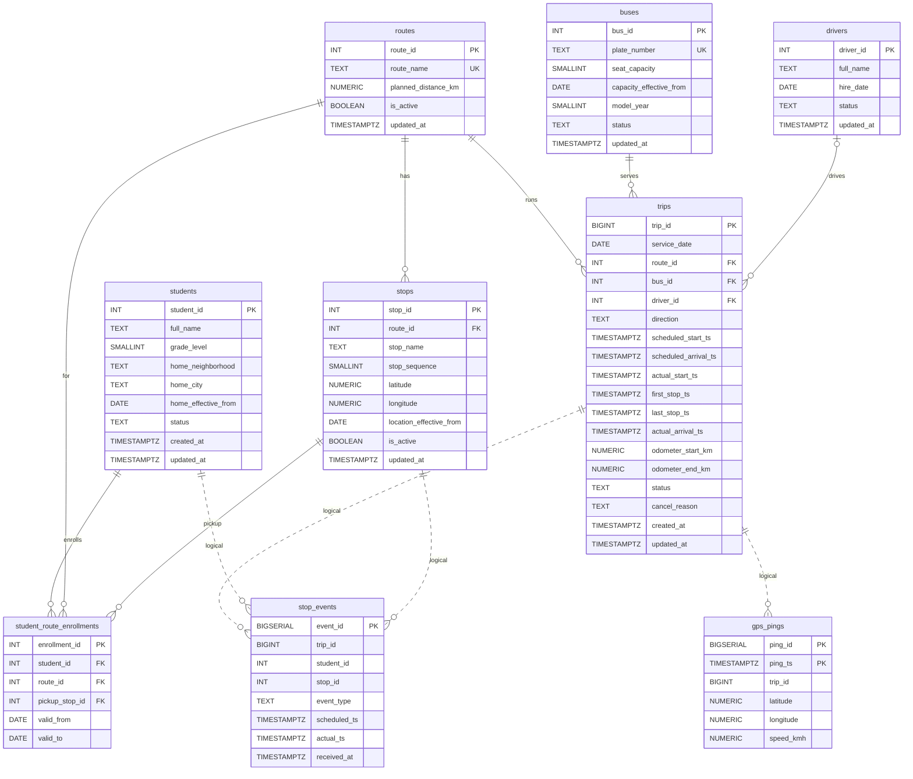

# OLTP schema (`oltp`)

Solid lines are foreign keys. Dotted lines are logical links without a database FK (raw ingestion tables).

## Notes
- `students`, `stops` and `buses` overwrite values in place and keep no history, which is why the warehouse needs SCD2.
- `stop_events` is append-only with at-least-once delivery, so duplicates are possible.
- `gps_pings` is partitioned by month on `ping_ts`.
- Timestamps are stored in UTC. Business time is Africa/Casablanca.